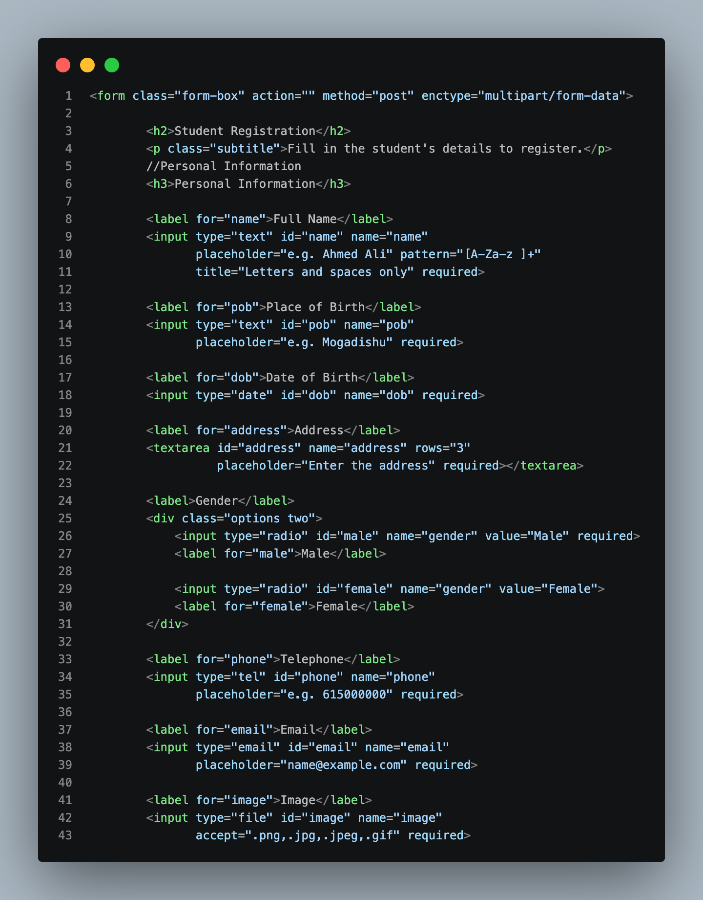
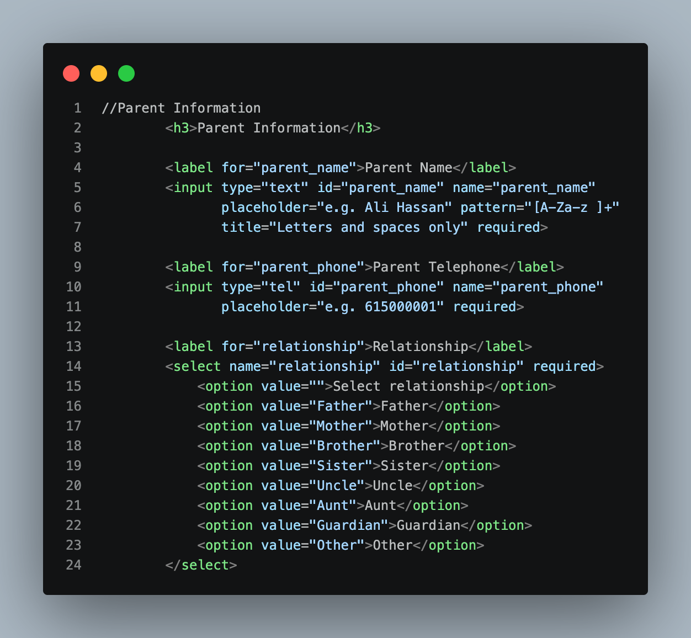
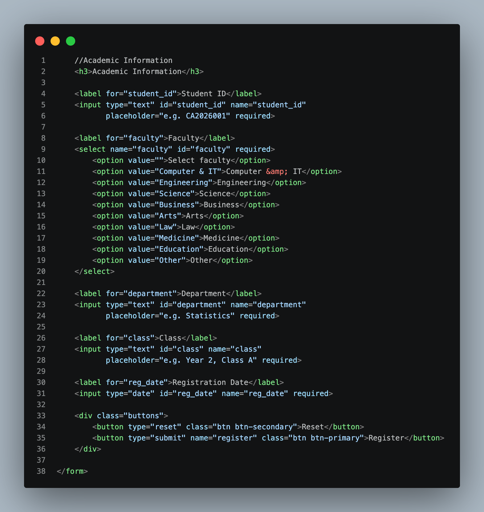
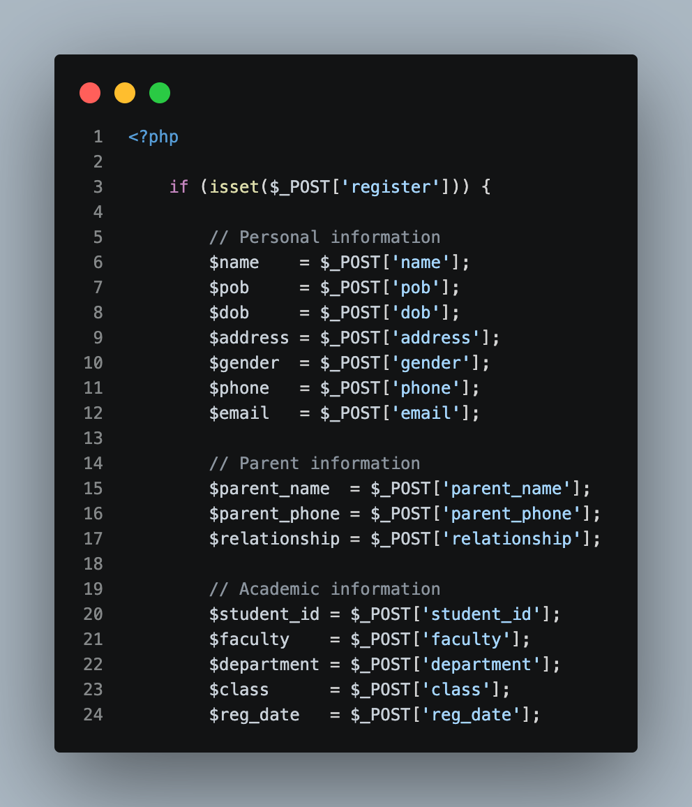
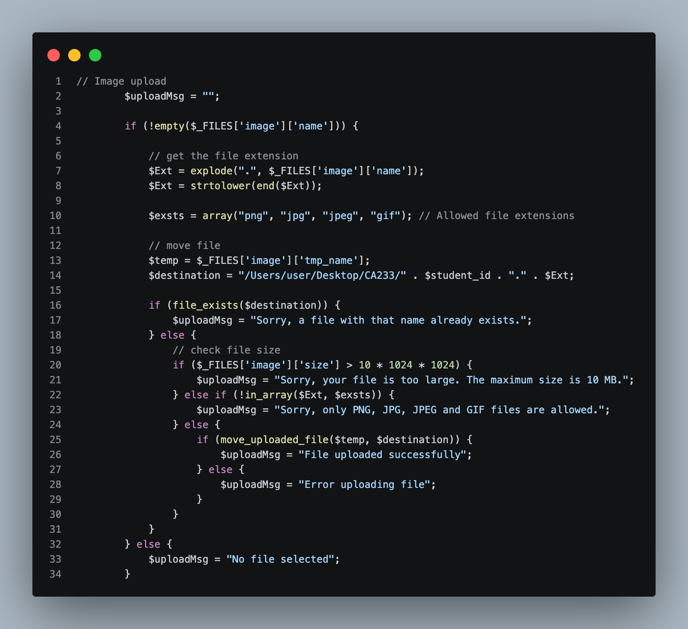
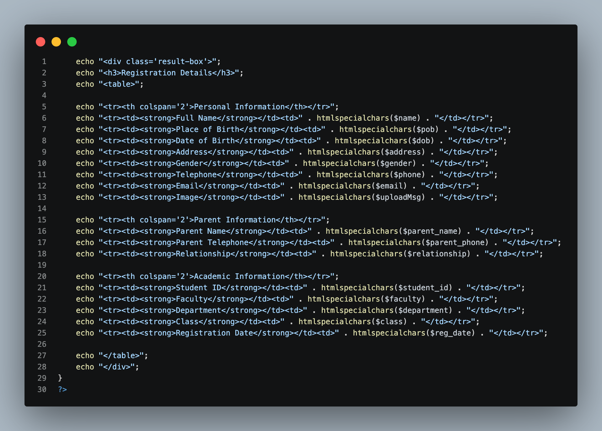

# Week 7 — Screenshots

## Overview

This README explains the screenshots inside the **Week 7 / Screenshots** folder for the **PHP & MySQL Course (CA233)**. Each screenshot shows one part of the code from **Assignment 4**. Under each screenshot, you will find a simple explanation of **what the code does and why it works**.

Week 7 has one topic:

- **Student Registration Form** (`Assignment4.php`): build a form with three sections, receive the data with PHP using `$_POST`, upload the student's image using `$_FILES`, and show everything back to the user in a table.

This week joins what we learned before (forms and `$_POST`) with Week 6 (file upload). One file does everything: the **form is at the top** and the **PHP code is at the bottom**.

| # | Filename | Source File | Section Documented |
|---|---|---|---|
| 1 | `Img1.png` | `Assignment4.php` | The form start and the **Personal Information** section |
| 2 | `Img2.png` | `Assignment4.php` | The **Parent Information** section |
| 3 | `Img3.png` | `Assignment4.php` | The **Academic Information** section and the buttons |
| 4 | `Img4.png` | `Assignment4.php` | PHP: checking the Register button and reading the form data |
| 5 | `Img5.png` | `Assignment4.php` | PHP: checking and saving the uploaded image |
| 6 | `Img6.png` | `Assignment4.php` | PHP: showing the registration details in a table |

---

## The Big Picture (read this first)

Here is the whole journey of the data, from the user's keyboard to the table on the screen:

```
User fills the form  →  clicks Register  →  browser sends the data (POST)
      →  PHP receives text in $_POST and the image in $_FILES
      →  PHP checks and saves the image
      →  PHP prints all the details in a table
```

The file has two parts:

| Part | What it is | Screenshots |
|---|---|---|
| **HTML** (top of the file) | The form the user sees and fills in | Img1, Img2, Img3 |
| **PHP** (bottom of the file) | The code that runs after Register is clicked | Img4, Img5, Img6 |

---

# Part 1: The HTML Form

## 1. `Img1.png` — Form Start and Personal Information



**What this screenshot shows:** the opening `<form>` tag, the page title, and the first section of the form: **Personal Information**. It has eight fields: Full Name, Place of Birth, Date of Birth, Address, Gender, Telephone, Email, and Image.

```html
<form class="form-box" action="" method="post" enctype="multipart/form-data">

        <h2>Student Registration</h2>
        <p class="subtitle">Fill in the student's details to register.</p>
        //Personal Information
        <h3>Personal Information</h3>

        <label for="name">Full Name</label>
        <input type="text" id="name" name="name"
               placeholder="e.g. Ahmed Ali" pattern="[A-Za-z ]+"
               title="Letters and spaces only" required>

        <label for="pob">Place of Birth</label>
        <input type="text" id="pob" name="pob"
               placeholder="e.g. Mogadishu" required>

        <label for="dob">Date of Birth</label>
        <input type="date" id="dob" name="dob" required>

        <label for="address">Address</label>
        <textarea id="address" name="address" rows="3"
                  placeholder="Enter the address" required></textarea>

        <label>Gender</label>
        <div class="options two">
            <input type="radio" id="male" name="gender" value="Male" required>
            <label for="male">Male</label>

            <input type="radio" id="female" name="gender" value="Female">
            <label for="female">Female</label>
        </div>

        <label for="phone">Telephone</label>
        <input type="tel" id="phone" name="phone"
               placeholder="e.g. 615000000" required>

        <label for="email">Email</label>
        <input type="email" id="email" name="email"
               placeholder="name@example.com" required>

        <label for="image">Image</label>
        <input type="file" id="image" name="image"
               accept=".png,.jpg,.jpeg,.gif" required>
```

**Theory: the `<form>` tag**

The `<form>` tag is the box that holds all the fields. Its attributes tell the browser what to do when the form is sent.

| Attribute | Value | What it means |
|---|---|---|
| `class` | `form-box` | A name for CSS. It is only used to style the form. |
| `action` | `""` (empty) | Send the data to **the same page**. This is why the form and the PHP code are in one file. |
| `method` | `post` | Send the data inside the request, so it is **not shown in the URL**. Good for personal information. |
| `enctype` | `multipart/form-data` | **Required to send a file.** Without it, the image is not sent. (Same as Week 6.) |

**Theory: `name`, `id`, and `for`**

These three are easy to mix up:

| Attribute | Used by | Purpose |
|---|---|---|
| `name` | **PHP** | The key in `$_POST`. `name="pob"` becomes `$_POST['pob']`. |
| `id` | HTML / CSS | A unique label for the field on the page. |
| `for` (on `<label>`) | HTML | Connects the label to the field with the **same `id`**. Clicking the label then selects the field. |

If the `name` in the HTML and the key in PHP are different, PHP will not find the data.

**Theory: the input types used in this section**

| Field | Type | What the browser does |
|---|---|---|
| Full Name, Place of Birth | `type="text"` | A normal one-line text box. |
| Date of Birth | `type="date"` | Shows a calendar picker. The value is sent as `yyyy-mm-dd`. |
| Address | `<textarea>` | A big box for many lines of text. `rows="3"` sets its height. |
| Gender | `type="radio"` | Round buttons. The user can choose only one. |
| Telephone | `type="tel"` | A phone number box. Phones show a number keyboard. |
| Email | `type="email"` | The browser checks for a valid email shape (for example `name@example.com`). |
| Image | `type="file"` | A **Choose File** button. The file arrives in `$_FILES` (see Img5). |

**Theory: the attributes that help the user**

| Attribute | What it does |
|---|---|
| `placeholder` | Grey example text inside the box (for example `e.g. Ahmed Ali`). It disappears when the user types. |
| `required` | The browser **will not send the form** if this field is empty. |
| `pattern="[A-Za-z ]+"` | The text must match this rule: only letters `A–Z`, `a–z`, and a space. Numbers and symbols are rejected. `+` means "one or more". |
| `title` | The message shown when the `pattern` rule fails ("Letters and spaces only"). |
| `accept=".png,.jpg,.jpeg,.gif"` | The file picker shows only these image types. |

**Theory: the radio buttons for Gender**

```html
<input type="radio" id="male" name="gender" value="Male" required>
<input type="radio" id="female" name="gender" value="Female">
```

- Both buttons have the **same `name`** (`gender`). That is what makes them a group, so only one can be selected at a time.
- The `value` is what PHP receives: `Male` or `Female`.
- `required` is written on the first button only, but it applies to the **whole group**. The user must choose one.

**Concepts demonstrated:**

- **`<form>` with `method="post"` and `enctype`:** sends text and a file.
- **`name` attribute:** the key PHP uses to read each field.
- **Input types:** `text`, `date`, `tel`, `email`, `radio`, `file`, and `<textarea>`.
- **`required`, `pattern`, `title`, `accept`:** checks done by the browser before sending.
- **Radio group:** same `name`, different `value`.

> **Note 1:** the lines `//Personal Information`, `//Parent Information`, and `//Academic Information` are written in the middle of the HTML. `//` is a PHP and JavaScript comment, but **it is not a comment in HTML**, so these words will be **shown on the web page** as plain text. The correct HTML comment is `<!-- Personal Information -->`.
>
> **Note 2:** the `pattern` and `required` checks run in the **browser only**. Someone can skip them (for example, with browser tools), so PHP should check the data again on the server. Also, `[A-Za-z ]` accepts only English letters, so a name with other letters will be rejected.

---

## 2. `Img2.png` — Parent Information



**What this screenshot shows:** the second section of the form, with three fields: Parent Name, Parent Telephone, and Relationship (a drop-down list).

```html
//Parent Information
        <h3>Parent Information</h3>

        <label for="parent_name">Parent Name</label>
        <input type="text" id="parent_name" name="parent_name"
               placeholder="e.g. Ali Hassan" pattern="[A-Za-z ]+"
               title="Letters and spaces only" required>

        <label for="parent_phone">Parent Telephone</label>
        <input type="tel" id="parent_phone" name="parent_phone"
               placeholder="e.g. 615000001" required>

        <label for="relationship">Relationship</label>
        <select name="relationship" id="relationship" required>
            <option value="">Select relationship</option>
            <option value="Father">Father</option>
            <option value="Mother">Mother</option>
            <option value="Brother">Brother</option>
            <option value="Sister">Sister</option>
            <option value="Uncle">Uncle</option>
            <option value="Aunt">Aunt</option>
            <option value="Guardian">Guardian</option>
            <option value="Other">Other</option>
        </select>
```

**Theory: `<h3>` section headings**

`<h3>` is a heading smaller than `<h2>`. The form uses `<h2>` for the page title and `<h3>` for each section. This makes the form easy to read and easy to style with CSS.

**Theory: the first two fields**

Parent Name and Parent Telephone work exactly like Full Name and Telephone in Img1. The parent name uses the same `pattern`, so it also allows **letters and spaces only**. Each field has its own `name` (`parent_name`, `parent_phone`), so PHP can tell the student's data and the parent's data apart.

**Theory: the drop-down list (`<select>`)**

A `<select>` shows a list. The user picks one item.

```html
<select name="relationship" id="relationship" required>
    <option value="">Select relationship</option>
    <option value="Father">Father</option>
    ...
</select>
```

| Part | Meaning |
|---|---|
| `<select name="relationship">` | The whole list. `name` is the key for PHP: `$_POST['relationship']`. |
| `<option value="Father">Father</option>` | One item. The `value` is what PHP receives. The text between the tags is what the user sees. |
| `<option value="">Select relationship</option>` | The first item is a "hint" with an **empty value**. |

**Why the first option has an empty value:** the `required` attribute checks if the value is empty. Since the hint option has `value=""`, the browser treats "Select relationship" as **not chosen** and will not send the form until the user picks a real item.

**Concepts demonstrated:**

- **`<h3>`:** headings for each section.
- **`<select>` and `<option>`:** a drop-down list, where `value` is what PHP receives.
- **Empty first option:** makes `required` work on a list.
- **Different `name` for each field:** keeps parent data separate from student data.

---

## 3. `Img3.png` — Academic Information and the Buttons



**What this screenshot shows:** the last section of the form (Student ID, Faculty, Department, Class, Registration Date), then the **Reset** and **Register** buttons, and the closing `</form>` tag.

```html
//Academic Information
    <h3>Academic Information</h3>

    <label for="student_id">Student ID</label>
    <input type="text" id="student_id" name="student_id"
           placeholder="e.g. CA2026001" required>

    <label for="faculty">Faculty</label>
    <select name="faculty" id="faculty" required>
        <option value="">Select faculty</option>
        <option value="Computer & IT">Computer &amp; IT</option>
        <option value="Engineering">Engineering</option>
        <option value="Science">Science</option>
        <option value="Business">Business</option>
        <option value="Arts">Arts</option>
        <option value="Law">Law</option>
        <option value="Medicine">Medicine</option>
        <option value="Education">Education</option>
        <option value="Other">Other</option>
    </select>

    <label for="department">Department</label>
    <input type="text" id="department" name="department"
           placeholder="e.g. Statistics" required>

    <label for="class">Class</label>
    <input type="text" id="class" name="class"
           placeholder="e.g. Year 2, Class A" required>

    <label for="reg_date">Registration Date</label>
    <input type="date" id="reg_date" name="reg_date" required>

    <div class="buttons">
        <button type="reset" class="btn btn-secondary">Reset</button>
        <button type="submit" name="register" class="btn btn-primary">Register</button>
    </div>

</form>
```

**Theory: the fields**

All fields here use things you already saw: `text` inputs, a `<select>` list for Faculty, and a `date` input for the Registration Date. The **Student ID** is important in this assignment, because PHP later uses it as the **name of the saved image file** (see Img5).

**Theory: why `&amp;` appears in the Faculty list**

```html
<option value="Computer & IT">Computer &amp; IT</option>
```

In HTML, the `&` symbol has a special meaning: it starts a code such as `&amp;` or `&lt;`. To show a real `&` on the page, you write **`&amp;`**. The browser displays it as `&`.

- The text the user sees: `Computer & IT` (written as `Computer &amp; IT`).
- The value PHP receives: `Computer & IT`.

**Theory: the two buttons**

| Button | Code | What it does |
|---|---|---|
| **Reset** | `type="reset"` | Clears everything the user typed in the form. It sends nothing. |
| **Register** | `type="submit" name="register"` | Sends the form. The `name="register"` is the key: PHP uses `isset($_POST['register'])` to know the Register button was clicked. |

The classes `btn`, `btn-secondary`, and `btn-primary` are only for the look of the buttons (CSS).

**Theory: closing the form**

`</form>` ends the form. Only the fields **inside** the form are sent. The PHP code that comes after the form (Img4 to Img6) runs after the form is submitted.

**Concepts demonstrated:**

- **`&amp;`:** how to write the `&` symbol in HTML.
- **`type="reset"` and `type="submit"`:** clear the form or send it.
- **`name="register"` on the submit button:** lets PHP detect the click.
- **`</form>`:** closes the form.

---

# Part 2: The PHP Code

## 4. `Img4.png` — Checking the Button and Reading the Data



**What this screenshot shows:** the start of the PHP code. It checks that the Register button was clicked, then copies every value from the form into a PHP variable.

```php
<?php

    if (isset($_POST['register'])) {

        // Personal information
        $name    = $_POST['name'];
        $pob     = $_POST['pob'];
        $dob     = $_POST['dob'];
        $address = $_POST['address'];
        $gender  = $_POST['gender'];
        $phone   = $_POST['phone'];
        $email   = $_POST['email'];

        // Parent information
        $parent_name  = $_POST['parent_name'];
        $parent_phone = $_POST['parent_phone'];
        $relationship = $_POST['relationship'];

        // Academic information
        $student_id = $_POST['student_id'];
        $faculty    = $_POST['faculty'];
        $department = $_POST['department'];
        $class      = $_POST['class'];
        $reg_date   = $_POST['reg_date'];
```

**Theory: `<?php`**

`<?php` tells the server: "from here, this is PHP code." The PHP code runs on the **server**, and the user only sees its output.

**Theory: `isset($_POST['register'])`**

When the page is opened for the first time, the form has **not** been sent yet, so `$_POST` is empty. We do not want to show results then. `isset()` checks if a value exists:

| Situation | `$_POST['register']` | `isset()` | The block runs? |
|---|---|---|---|
| The page is just opened | does not exist | `false` | No |
| The user clicks Register | exists | `true` | Yes |

This works because the Register button has `name="register"` (Img3).

**Theory: `$_POST` and variables**

`$_POST` is a PHP **array** that holds the text from the form. The key is the `name` from the HTML. The code copies each value into a simple variable to make it easier to use later.

Here is how the HTML `name` connects to PHP:

| HTML field `name` | PHP code | Variable |
|---|---|---|
| `name="name"` | `$_POST['name']` | `$name` |
| `name="pob"` | `$_POST['pob']` | `$pob` |
| `name="dob"` | `$_POST['dob']` | `$dob` |
| `name="parent_name"` | `$_POST['parent_name']` | `$parent_name` |
| `name="student_id"` | `$_POST['student_id']` | `$student_id` |
| `name="reg_date"` | `$_POST['reg_date']` | `$reg_date` |

The other fields follow the same rule. The lines starting with `//` are **PHP comments**. They are notes for the programmer, and PHP ignores them.

> **Note:** the **image** is not in this list. A file does not come in `$_POST`. It comes in `$_FILES`, which is handled in the next screenshot.

**Concepts demonstrated:**

- **`<?php`:** starts PHP code.
- **`isset()`:** checks that the Register button was clicked.
- **`$_POST`:** an array with the form's text, using the field `name` as the key.
- **Variables:** `$name = $_POST['name'];` stores the value for later use.
- **`//` comments:** notes inside PHP.

---

## 5. `Img5.png` — Checking and Saving the Image



**What this screenshot shows:** the code that handles the uploaded image. It checks the file step by step. If everything is fine, it saves the image. Whatever happens, it stores a **message** in `$uploadMsg` so we can show the result in the table.

```php
// Image upload
        $uploadMsg = "";

        if (!empty($_FILES['image']['name'])) {

            // get the file extension
            $Ext = explode(".", $_FILES['image']['name']);
            $Ext = strtolower(end($Ext));

            $exsts = array("png", "jpg", "jpeg", "gif"); // Allowed file extensions

            // move file
            $temp = $_FILES['image']['tmp_name'];
            $destination = "/Users/user/Desktop/CA233/" . $student_id . "." . $Ext;

            if (file_exists($destination)) {
                $uploadMsg = "Sorry, a file with that name already exists.";
            } else {
                // check file size
                if ($_FILES['image']['size'] > 10 * 1024 * 1024) {
                    $uploadMsg = "Sorry, your file is too large. The maximum size is 10 MB.";
                } else if (!in_array($Ext, $exsts)) {
                    $uploadMsg = "Sorry, only PNG, JPG, JPEG and GIF files are allowed.";
                } else {
                    if (move_uploaded_file($temp, $destination)) {
                        $uploadMsg = "File uploaded successfully";
                    } else {
                        $uploadMsg = "Error uploading file";
                    }
                }
            }
        } else {
            $uploadMsg = "No file selected";
        }
```

This is the same idea as Week 6, with more checks. Here is the whole process in order:

```
Was a file selected?  ──No──►  "No file selected"
        │Yes
        ▼
Get the extension (png, jpg ...)  →  build the destination path
        ▼
Does this file name already exist?  ──Yes──►  "a file with that name already exists"
        │No
        ▼
Is it bigger than 10 MB?  ──Yes──►  "your file is too large"
        │No
        ▼
Is the extension allowed?  ──No──►  "only PNG, JPG, JPEG and GIF files are allowed"
        │Yes
        ▼
Move the file  ──worked──►  "File uploaded successfully"
              └─failed──►  "Error uploading file"
```

**Theory: `$uploadMsg`**

`$uploadMsg = "";` creates an empty message. Every path in the code puts a text into it. At the end (Img6), this message is printed in the **Image** row of the table.

**Theory: was a file selected?**

```php
if (!empty($_FILES['image']['name'])) { ... } else { $uploadMsg = "No file selected"; }
```

If no file was chosen, the `name` is an empty text. `empty()` is `true` for an empty text, and `!` reverses it. So the main block runs **only when a file was really chosen**.

**Theory: getting the file extension**

```php
$Ext = explode(".", $_FILES['image']['name']);
$Ext = strtolower(end($Ext));
```

Let's say the file is `photo.PNG`:

| Step | Code | Result |
|---|---|---|
| 1. Cut the name at every dot | `explode(".", "photo.PNG")` | `["photo", "PNG"]` |
| 2. Take the last piece | `end($Ext)` | `"PNG"` |
| 3. Make it lowercase | `strtolower(...)` | `"png"` |

Lowercase is used so `PNG`, `Png`, and `png` are all treated the same.

**Theory: the allowed list**

```php
$exsts = array("png", "jpg", "jpeg", "gif");
```

This is an array of the extensions we accept. Later, `in_array($Ext, $exsts)` checks whether the file's extension is in this list. The `!` in front means "is **not** in the list", which is the error case.

**Theory: the destination (where the file is saved)**

```php
$temp = $_FILES['image']['tmp_name'];
$destination = "/Users/user/Desktop/CA233/" . $student_id . "." . $Ext;
```

- `$temp`: PHP first saves the upload in a **temporary** place. If we do nothing, it is deleted when the script ends.
- `$destination`: the folder path, plus the **Student ID**, plus a dot, plus the extension. Example: `/Users/user/Desktop/CA233/CA2026001.png`.
- The dots `.` between the parts are the **concatenation** operator (they join text).

Naming the file with the Student ID gives each student a different file name.

**Theory: the checks**

| Check | Code | Why |
|---|---|---|
| Name already used | `file_exists($destination)` | Stops one student's image from replacing another's. |
| Too big | `$_FILES['image']['size'] > 10 * 1024 * 1024` | `size` is in **bytes**. `10 * 1024 * 1024` is 10 MB. |
| Wrong type | `!in_array($Ext, $exsts)` | Only images are accepted. |

The `else if` makes the checks **run one after the other**. When one fails, its message is saved and the later checks are skipped.

**Theory: `move_uploaded_file()`**

```php
if (move_uploaded_file($temp, $destination)) { ... }
```

It moves the file from the temporary place to the permanent folder. It returns `true` if it worked and `false` if it failed. It is safer than `copy()` because it first confirms that the file **really came from an upload**.

**Possible messages:**

| Message | Meaning |
|---|---|
| `No file selected` | The user did not choose an image. |
| `Sorry, a file with that name already exists.` | A file with this Student ID is already saved. |
| `Sorry, your file is too large...` | The image is bigger than 10 MB. |
| `Sorry, only PNG, JPG, JPEG and GIF files are allowed.` | The file is not an allowed image type. |
| `File uploaded successfully` | The image was saved. |
| `Error uploading file` | The move failed (see below). |

**Common reasons for `Error uploading file`:**

- The folder `/Users/user/Desktop/CA233/` **does not exist**. Create it first.
- PHP **does not have permission** to write to that folder.
- The `user` in the path is not your real Mac username.
- The file is bigger than the limit in `php.ini` (`upload_max_filesize` and `post_max_size`).
- On another computer, the path must change (for example `C:/xampp/htdocs/uploads/` on Windows).

**Concepts demonstrated:**

- **`$_FILES`:** the array that describes the uploaded file (`name`, `size`, `tmp_name`).
- **`explode()` and `end()`:** get the file extension.
- **`strtolower()`:** make text lowercase for a fair comparison.
- **`array()` and `in_array()`:** an allowed list, and a check against it.
- **`file_exists()`:** avoid replacing an existing file.
- **`if / else if / else`:** check one rule after another.
- **`move_uploaded_file()`:** save the upload permanently.
- **Concatenation `.`:** build the destination path.

> **Notes:**
> - **The Student ID is used inside the file path as the user typed it.** If someone types `../` or `/` in the Student ID, the file could be saved in a different place. In a real project, clean it first (for example with `basename()`) or check that it has only letters and numbers.
> - **The extension is only the file's name.** Someone can rename `virus.php` to `virus.png`. In a real project, also check that the file is a real image (for example with `getimagesize()`).
> - **The image is saved to the Desktop folder, so it cannot be shown on the web page.** The table only shows the message. To show the picture, save it inside the project folder (like `uploads/`) and use ``.

---

## 6. `Img6.png` — Showing the Details in a Table



**What this screenshot shows:** the last part of the PHP code. It prints all the submitted information back to the user in a **table**, with one group of rows for each section. Then it closes the `if` block and the PHP tag.

```php
echo "<div class='result-box'>";
    echo "<h3>Registration Details</h3>";
    echo "<table>";

    echo "<tr><th colspan='2'>Personal Information</th></tr>";
    echo "<tr><td><strong>Full Name</strong></td><td>" . htmlspecialchars($name) . "</td></tr>";
    echo "<tr><td><strong>Place of Birth</strong></td><td>" . htmlspecialchars($pob) . "</td></tr>";
    echo "<tr><td><strong>Date of Birth</strong></td><td>" . htmlspecialchars($dob) . "</td></tr>";
    echo "<tr><td><strong>Address</strong></td><td>" . htmlspecialchars($address) . "</td></tr>";
    echo "<tr><td><strong>Gender</strong></td><td>" . htmlspecialchars($gender) . "</td></tr>";
    echo "<tr><td><strong>Telephone</strong></td><td>" . htmlspecialchars($phone) . "</td></tr>";
    echo "<tr><td><strong>Email</strong></td><td>" . htmlspecialchars($email) . "</td></tr>";
    echo "<tr><td><strong>Image</strong></td><td>" . htmlspecialchars($uploadMsg) . "</td></tr>";

    echo "<tr><th colspan='2'>Parent Information</th></tr>";
    echo "<tr><td><strong>Parent Name</strong></td><td>" . htmlspecialchars($parent_name) . "</td></tr>";
    echo "<tr><td><strong>Parent Telephone</strong></td><td>" . htmlspecialchars($parent_phone) . "</td></tr>";
    echo "<tr><td><strong>Relationship</strong></td><td>" . htmlspecialchars($relationship) . "</td></tr>";

    echo "<tr><th colspan='2'>Academic Information</th></tr>";
    echo "<tr><td><strong>Student ID</strong></td><td>" . htmlspecialchars($student_id) . "</td></tr>";
    echo "<tr><td><strong>Faculty</strong></td><td>" . htmlspecialchars($faculty) . "</td></tr>";
    echo "<tr><td><strong>Department</strong></td><td>" . htmlspecialchars($department) . "</td></tr>";
    echo "<tr><td><strong>Class</strong></td><td>" . htmlspecialchars($class) . "</td></tr>";
    echo "<tr><td><strong>Registration Date</strong></td><td>" . htmlspecialchars($reg_date) . "</td></tr>";

    echo "</table>";
    echo "</div>";
}
?>
```

**Theory: `echo`**

`echo` prints text (including HTML code) to the page. The browser then shows the HTML that PHP printed. So PHP builds the table, and the browser draws it.

**Theory: the HTML table tags**

| Tag | Meaning |
|---|---|
| `<table>` | The whole table. |
| `<tr>` | One **row**. |
| `<th>` | A **heading** cell (bold). |
| `<td>` | A normal **data** cell. |
| `colspan='2'` | Makes one cell stretch across **two columns**. |

The table has **two columns**: the label (like "Full Name") and the value. Each section starts with a heading row, such as:

```php
echo "<tr><th colspan='2'>Personal Information</th></tr>";
```

The `colspan='2'` makes the heading stretch across both columns, so it acts like a title for the rows below it.

**Theory: how one row is built**

```php
echo "<tr><td><strong>Full Name</strong></td><td>" . htmlspecialchars($name) . "</td></tr>";
```

The line joins three pieces of text with the dot `.`:

| Piece | What it is |
|---|---|
| `"<tr><td><strong>Full Name</strong></td><td>"` | Start of the row, the label in bold, and the start of the value cell. |
| `htmlspecialchars($name)` | The value that the user typed. |
| `"</td></tr>"` | End of the value cell and the row. |

Every row in the table uses this same pattern, only with a different label and variable.

**Theory: `htmlspecialchars()`**

Everything the user types should be treated as **text only**, never as code. `htmlspecialchars()` changes special characters into safe codes, for example `<` becomes `&lt;`.

| What the user typed | Without `htmlspecialchars()` | With `htmlspecialchars()` |
|---|---|---|
| `Ahmed` | Ahmed | Ahmed |
| `<b>Ahmed</b>` | **Ahmed** (the page treats it as code) | `<b>Ahmed</b>` (shown as plain text) |

This protects against **XSS** (Cross-Site Scripting), where an attacker types code, such as a `<script>`, into a field to run it in someone else's browser. Every value in this table is protected, including `$uploadMsg`.

**Theory: closing everything**

- `echo "</table>";` and `echo "</div>";` close the table and the box.
- `}` closes the `if (isset($_POST['register']))` block that opened in Img4.
- `?>` ends the PHP code.

Because everything is inside that `if`, the result box is shown **only after** the Register button is clicked.

**Example result** (after filling the form and clicking Register):

```
Registration Details
┌──────────────────────────────────────────┐
│ Personal Information                     │
├────────────────────┬─────────────────────┤
│ Full Name          │ Ahmed Ali           │
│ Place of Birth     │ Mogadishu           │
│ ...                │ ...                 │
│ Image              │ File uploaded       │
│                    │ successfully        │
├────────────────────┴─────────────────────┤
│ Parent Information                       │
├────────────────────┬─────────────────────┤
│ Parent Name        │ Ali Hassan          │
│ ...                │ ...                 │
├────────────────────┴─────────────────────┤
│ Academic Information                     │
├────────────────────┬─────────────────────┤
│ Student ID         │ CA2026001           │
│ ...                │ ...                 │
└────────────────────┴─────────────────────┘
```

**Concepts demonstrated:**

- **`echo`:** prints HTML from PHP.
- **HTML table:** `<table>`, `<tr>`, `<th>`, `<td>`, and `colspan`.
- **Concatenation `.`:** joins the HTML and the values.
- **`htmlspecialchars()`:** shows user input safely (protects against XSS).
- **Closing `}` and `?>`:** ends the `if` block and the PHP code.

---

## Quick Summary

| Step | What happens | Where |
|---|---|---|
| 1 | The user fills in the three sections | HTML form (Img1, Img2, Img3) |
| 2 | The user clicks **Register** | `name="register"` on the button |
| 3 | PHP sees the click and reads the text fields | `isset()` and `$_POST` (Img4) |
| 4 | PHP checks the image and saves it | `$_FILES` and `move_uploaded_file()` (Img5) |
| 5 | PHP shows everything in a table | `echo` and `htmlspecialchars()` (Img6) |

---

## Screenshot Folder Structure

```
Week 7/
├── Assignment4.php
└── Screenshots/
    ├── Img1.png
    ├── Img2.png
    ├── Img3.png
    ├── Img4.png
    ├── Img5.png
    ├── Img6.png
    └── README.md
```

The stylesheet `style2.css` is one folder **above** `Assignment4.php`, because the file links to it as `../style2.css`.

Each image above matches the numbered section in this README. `Img1`, `Img2`, and `Img3` come from the **HTML form** at the top of `Assignment4.php`. `Img4`, `Img5`, and `Img6` come from the **PHP code** at the bottom of the same file.
