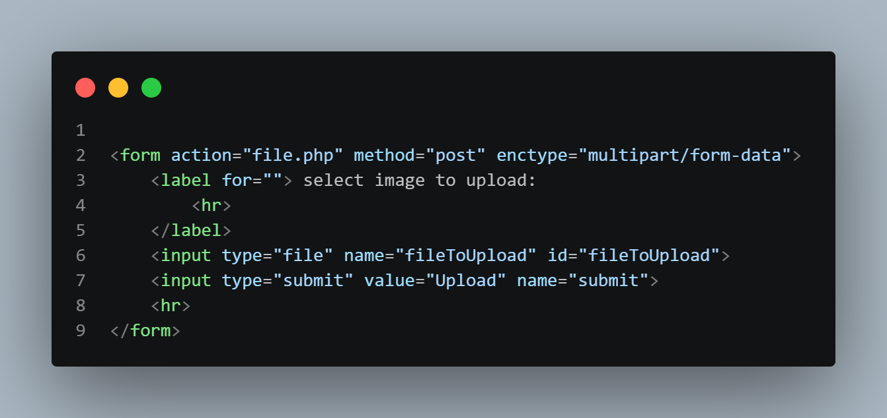
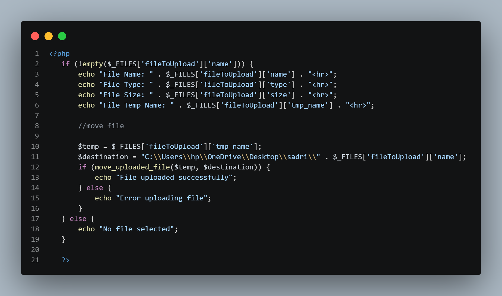

# Week 6 — Code Screenshots

## Introduction

This README documents the screenshots inside the **Week 6 / screenshots** directory for the **PHP & MySQL Course (CA233)**. Week 6 is about **uploading files with PHP**. The work consists of an HTML form that lets the user choose a file and send it to the server, and a PHP script that reads the uploaded file's information from `$_FILES`, prints it, and moves the file from its temporary location to a chosen folder.

The two screenshots below are listed in the order the work flows: first the form that sends the file, then the PHP code that receives and handles it (`week6_2.png`, then `week6_1.png`).

| # | Filename | What It Covers |
|---|---|---|
| 1 | `week6_2.png` | The HTML upload form: `enctype="multipart/form-data"`, the file input, and the Upload button |
| 2 | `week6_1.png` | The PHP code that prints the file's details and moves the uploaded file with `move_uploaded_file()` |

---

## 1. `week6_2.png` — The File Upload Form



**What's in the image:** a complete HTML form that lets the user pick a file and submit it.

**Detailed breakdown:**

- **Opening the form:** `<form action="file.php" method="post" enctype="multipart/form-data">` sends the form to `file.php` using the `post` method. The `enctype="multipart/form-data"` attribute is what allows the browser to send a file along with the form.
- **The label:** `<label for=""> select image to upload:` shows the instruction text, with an `<hr>` line inside the label before it closes with `</label>`.
- **The file input:** `<input type="file" name="fileToUpload" id="fileToUpload">` creates the file chooser. Its `name`, `fileToUpload`, is the key PHP uses to find the file in `$_FILES`.
- **The submit button:** `<input type="submit" value="Upload" name="submit">` shows a button labeled `Upload` that sends the form.
- **Closing the form:** another `<hr>` adds a line, and `</form>` ends the form.
- **A detail worth flagging:** the label's `for` attribute is empty (`for=""`), so it isn't linked to the file input. To link them, it would need to match the input's `id`, which is `fileToUpload`.
- **Another detail:** the label says `select image to upload`, but the file input has no `accept` attribute, so the browser will let the user choose any type of file.

**Why this matters:** A form can only send a file if it uses `method="post"` together with `enctype="multipart/form-data"`, and the `name` of the file input is the key that connects the form to the PHP code that handles the upload.

---

## 2. `week6_1.png` — Reading the Uploaded File and Moving It



**What's in the image:** a PHP block that checks whether a file was chosen, prints its details from `$_FILES`, and moves it to a destination folder.

**Detailed breakdown:**

- **Checking that a file was chosen:** `if (!empty($_FILES['fileToUpload']['name'])) {` runs the upload code only when the file input has a file name. The matching `else` at the end prints `"No file selected"`.
- **Printing the file's details:** four `echo` lines print information about the uploaded file, each followed by `"<hr>"`:
  - `$_FILES['fileToUpload']['name']` is printed as `File Name`.
  - `$_FILES['fileToUpload']['type']` is printed as `File Type`.
  - `$_FILES['fileToUpload']['size']` is printed as `File Size`.
  - `$_FILES['fileToUpload']['tmp_name']` is printed as `File Temp Name`.
- **Preparing to move the file:** after the `//move file` comment, `$temp = $_FILES['fileToUpload']['tmp_name'];` stores the temporary location where PHP first saves the upload. `$destination` is built from a folder path on the computer (`C:\\Users\\hp\\OneDrive\\Desktop\\sadri\\`) joined with `$_FILES['fileToUpload']['name']`, so the file keeps its original name.
- **Moving the file:** `if (move_uploaded_file($temp, $destination)) {` moves the file from the temporary location to the destination. If it works, `"File uploaded successfully"` is printed, and otherwise `"Error uploading file"` is printed.
- **Closing the block:** `}` closes the main `if`/`else`, and `?>` ends the PHP block.
- **A detail worth flagging:** the destination is a fixed path on one computer, so the code will only work on a machine that has that folder. Using a folder inside the project (for example, an `uploads` folder) would make it work anywhere.
- **Another detail:** the file is saved under the name the user uploaded, with no checks on file type or size. A file with the same name already in the folder would be replaced.

**Why this matters:** This shows the full upload flow in PHP — `$_FILES` holds the file's name, type, size, and temporary location, and `move_uploaded_file()` is what actually saves the file to its final place, with `if`/`else` messages telling the user what happened.

---

## Concepts at a Glance

| Concept | Where It Appears | Key Idea |
|---|---|---|
| `enctype="multipart/form-data"` | `week6_2.png` | Required on the form so the browser can send a file |
| `<input type="file">` | `week6_2.png` | Lets the user choose a file, and its `name` is the key used in `$_FILES` |
| `action` and `method="post"` | `week6_2.png` | Sends the form to `file.php` with the `post` method |
| Label `for` and input `id` | `week6_2.png` | `for` must match the input's `id` to link a label to its input |
| `$_FILES` | `week6_1.png` | An array holding the uploaded file's `name`, `type`, `size`, and `tmp_name` |
| `!empty()` check | `week6_1.png` | Confirms a file was selected before the upload code runs |
| Temporary file (`tmp_name`) | `week6_1.png` | The place where PHP first stores the upload before it is moved |
| `move_uploaded_file()` | `week6_1.png` | Moves the file from the temporary location to the destination path |
| `if` / `else` messages | `week6_1.png` | Prints a success message, an error message, or `No file selected` |
| Joining text with `.` | `week6_1.png` | Builds the output lines and the `$destination` path |

---

## Screenshot Folder Structure

```
Week6/
└── screenshots/
    ├── week6_1.png
    └── week6_2.png
```

Each screenshot above corresponds to its matching numbered section in this README. The sections follow the order of the work (form first, then the PHP that handles it), which is the reverse of the file numbering. The underlying source code these screenshots were captured from lives in the parent `Week6` folder.
